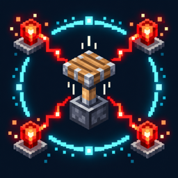

# TickWeave · 刻络

**English** | [简体中文](README.zh-CN.md)



TickWeave is a Fabric mod for observing Minecraft redstone **microtiming**. Freeze game ticks, step through a circuit, and inspect server-recorded piston block events and redstone dust evaluations. The client displays execution order, event depth, and observed propagation links, making it easier to analyze BED encoders, decoders, and other order-sensitive contraptions.

## Features

- **Piston execution order:** Mark piston events as `#1`, `#2`, and so on in the order they actually execute within a game tick.
- **Block event depth:** Mark causal layers as `D1`, `D2`, and so on, with arrows between parent and child events when that relationship can be confirmed.
- **Redstone dust tracking:** Show observed dust power, associated event depths, and direct trigger relationships within the selected tick.
- **Piston state diagnostics:** Record power both when an event is queued and when it executes, distinguishing actual extension, retraction, unchanged state, and cancellation.
- **0t redstone block output:** Detect an extension that pushes a redstone block followed by a block-dropping retraction in the same tick, and mark the physical output in the second block space.
- **Trace history:** Browse the latest 40 ticks with recorded events or inspect individual events within a coordinate range.
- **Configurable display:** Control piston and dust overlays separately, and adjust world text, HUD, colors, distance, and hotkeys.

## Installation

1. Download the `tickweave-*.jar` for your Minecraft version from GitHub Actions or Releases. A `-sources.jar` contains source code and is not an installable mod.
2. **Singleplayer:** Put TickWeave, Fabric API, and MaLiLib in the client's `mods` folder.
3. **Multiplayer:** Install the same TickWeave version and Fabric API on the server as well as the client. MaLiLib and Mod Menu are only needed on the client.
4. Start the game and confirm that **TickWeave** appears in the mod list.

When upgrading a world from 26.1.2 to 26.2, replace the old TickWeave JAR and version-specific dependencies on the client and server. Use the same TickWeave version on both sides in multiplayer. Your existing `config/tickweave.json` can remain in place; check your display settings after the first launch. Run GitHub Actions manually on `LTS/26.2` to build an artifact; run it on `main` to publish a Release.

## Usage

In a world where you can use `/tick`, enable the overlay and freeze game ticks:

```text
/tickweave on
/tick freeze
```

Trigger a redstone signal, then advance one game tick at a time:

```text
/tick step 1
```

Look for order and depth labels above pistons and for labels on redstone dust. If the signal passes through an observer or another delayed component, advance additional ticks.

### Client commands

- `/tickweave on` and `/tickweave off`: Enable or disable the visualization.
- `/tickweave prev` and `/tickweave next`: Select an earlier or later recorded tick.
- `/tickweave clear`: Clear the client's current trace history.
- `/tickweave config`: Open the MaLiLib settings screen.
- `/tickweave inspect <x1> <y1> <z1> <x2> <y2> <z2>`: Inspect the cuboid defined by two opposite corners.

For example:

```text
/tickweave clear
/tick step 1
/tickweave inspect 0 64 0 10 70 10
```

`inspect` summarizes actual extensions, retractions, cancellations, dust power changes, and 0t redstone block outputs. It prints the last 48 matching details with their game tick and order within that tick. Use `prev` or `inspect` to find brief extensions that happened before a later retraction. Narrow the coordinate range if the output is too large; the summary still includes all matching records.

Traces are collected and rendered only while ticks are frozen. The client receives records from the same dimension within 96 blocks of the player; world labels are also limited by the configured render distance.

## Reading the labels

- Large `#3` above a piston: This is the third piston event **executed** in the selected game tick.
- `D2 · produced D3`: This event belongs to the second causal layer and produced a child event in the third layer. A single piston does not have two depths, and the numbers are not added together. Root events are `D1`.
- `D2,3 P15` on redstone dust: This position was associated with second- and third-layer events during the tick; its last observed power was 15. `R` means no parent block event could be attributed. It does not automatically identify a reference or reset line.
- `E0→E1` and `E1→E0`: The piston's `extended` state changed to extended or retracted, respectively. `E0→E0` means the event did not actually extend the piston.
- “Queued power 1→execution power 0”: The event was powered when queued but unpowered when processed. This can explain some cancelled extension events.
- `R10→01`: Redstone block occupancy in the first and second spaces in front of a piston changed from `10` to `01`. A moving redstone block counts as occupied.

The **0t redstone block output** label appears only when both an extension pushing a redstone block and a later block-dropping retraction are observed in the same game tick. It describes a physical output; it does not mean that an event depth was “consumed.”

## Configuration and languages

Run `/tickweave config`, or use the Mod Menu configuration button, to open the MaLiLib settings screen. Client settings are saved in `config/tickweave.json`; size and color changes can be previewed immediately.

- **Visibility:** Master switch plus separate piston event and redstone dust switches.
- **Text:** Overall world-label scale and separate sizes for piston order, event details, and dust labels.
- **HUD:** Overall scale and screen X/Y position.
- **Colors:** HUD text and background, trigger arrows, and cycling colors for D1–D6.
- **Distance:** World-label render distance from 8 to 96 blocks.
- **Hotkeys:** Toggle the overlay, select the previous or next tick, and open settings; all are unbound by default.

The interface follows the game's language setting. Simplified Chinese, Traditional Chinese, and English are provided; other languages fall back to English. Color settings change text or arrow colors. The font comes from the active Minecraft resource pack.

## Development and build

Install JDK 25 for the current build target, then run this from the project root:

```sh
./gradlew build
```

On Windows, use `gradlew.bat build`. The installable JAR is written to `build/libs/`. The first build needs network access to download Gradle, Minecraft, Fabric, and optional UI library dependencies. In IntelliJ IDEA, import the project's root `build.gradle` as a Gradle project and set the Gradle JVM to JDK 25.

Server-side block event collection is in [`ServerLevelMixin`](src/main/java/top/xinsin/tickweave/mixin/ServerLevelMixin.java). Redstone dust evaluation context is in [`WireContext`](src/main/java/top/xinsin/tickweave/server/WireContext.java). [`TraceBroadcaster`](src/main/java/top/xinsin/tickweave/server/TraceBroadcaster.java) sends network fragments, and [`TickWeaveClient`](src/main/java/top/xinsin/tickweave/client/TickWeaveClient.java) renders them. [`ClientSettings`](src/main/java/top/xinsin/tickweave/client/ClientSettings.java) stores settings, and [`MasaConfigBridge`](src/main/java/top/xinsin/tickweave/client/MasaConfigBridge.java) provides the MaLiLib screen.

[GitHub Actions](.github/workflows/build.yml) runs only when started manually with **Run workflow**. Select the branch to build; the workflow checks its latest commit subject and builds the JAR. A successful run on `main` also publishes a Release for a new version. A passing run confirms the latest commit format and build; visual behavior still needs in-game verification.

## Release process

1. Update `mod_version` in `gradle.properties`, for example to `1.0.0`.
2. Add `release-notes/1.0.0.md`. Its first line must be `# TickWeave 1.0.0`; describe what the version adds and changes below it.
3. Push the code and notes to `main`, then select `main` and manually run [GitHub Actions](.github/workflows/build.yml). After a successful build, CI publishes the installable JAR to GitHub Releases with the version number itself as the tag, such as `1.0.0`.

Each version is published once. Later manual runs still build but do not overwrite an existing Release. To publish another version, update the version number and add its notes file. See the [0.6.1 release notes](release-notes/0.6.1.md) for the current 26.2 build.

## Contributing and commit format

**Every commit subject must use the format `Emoji Type: Short description`.** The emoji, capitalization, colon, and single space after the colon must match one of these prefixes; the description cannot be empty:

- `➕ Feat: ` New feature
- `🚧 Fix: ` Bug fix
- `📝 Docs: ` Documentation
- `♻️ Refactor: ` Refactoring without behavior changes
- `🧪 Test: ` Tests
- `🔧 Chore: ` Maintenance
- `🏗️ Build: ` Build or dependencies
- `👷 CI: ` Continuous integration
- `⚡ Perf: ` Performance

Valid examples:

```text
➕ Feat: Add redstone dust depth labels
🚧 Fix: Correct piston event order display
📝 Docs: Update installation instructions
```

Subjects such as `feat: ...`, `Fix: ...`, or `➕ feat: ...` fail the check. A manual CI run checks the **latest commit subject** on the selected branch. When merging a pull request, use a compliant final commit subject too; a default merge-commit subject may fail the check.

## License

TickWeave is licensed under the **MIT License**. See [LICENSE](LICENSE) for the full text.
